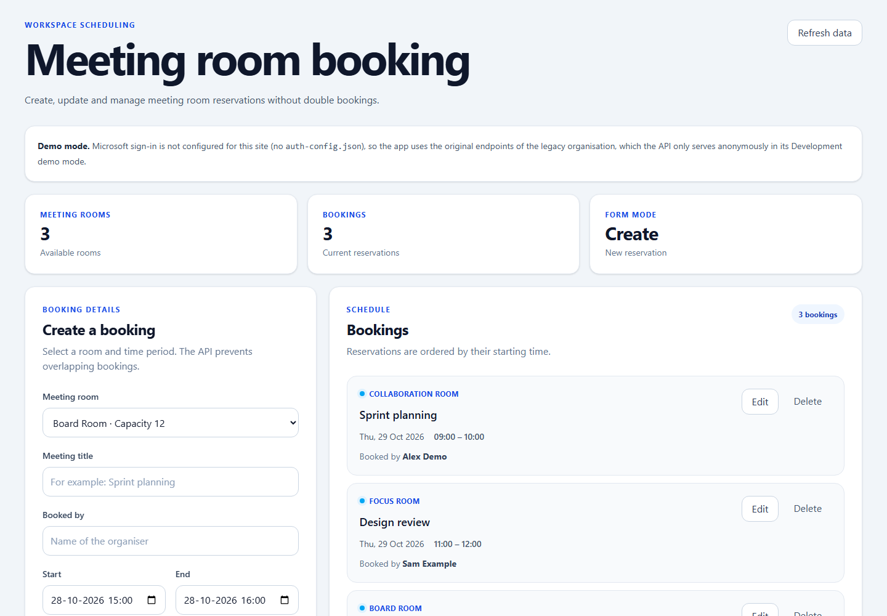
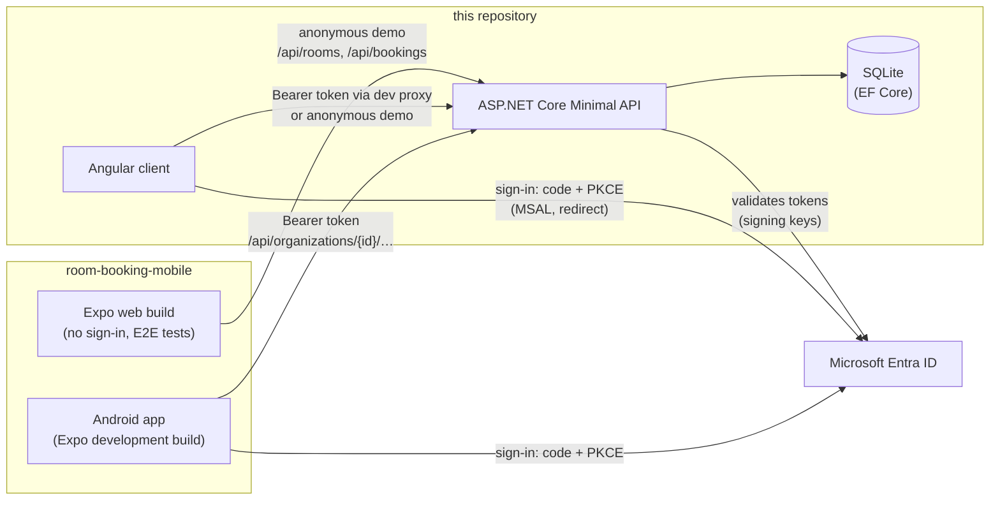

# Room Booking: API and web client

[](https://github.com/kris7011/meeting-room-booking/actions/workflows/ci.yml)

A multi-tenant meeting room booking platform. Organisations manage their own
rooms and members; members find a free room for a number of people at a
given time and book it, without double bookings and without ever seeing
another organisation's data.

This repository holds the **ASP.NET Core API** (.NET 10, EF Core, SQLite) and
the **Angular web client**. The **mobile app** (React Native / Expo, Android)
is in [kris7011/room-booking-mobile](https://github.com/kris7011/room-booking-mobile).



*Angular client in its credential-free demo mode, with synthetic bookings
created by `scripts/Start-Demo.ps1`. Mobile screenshots are in the
[mobile README](https://github.com/kris7011/room-booking-mobile#readme).*

## What it does

- **Self-service organisations.** Any signed-in user creates an organisation
  and becomes its Owner; a user can belong to several.
- **Rooms.** Owners and Admins create, rename, resize, archive and restore
  rooms. Archived rooms keep their booking history.
- **Invitations and members.** Owners invite Admins and Members, Admins
  invite Members. Accepting needs the invitation token *and* a verified
  e-mail matching the invitation. Owners change roles and remove members;
  the last Owner can never be removed or demoted.
- **Search and booking.** Find the smallest free room for N people in a time
  slot; book it; change or delete your own bookings (Owners and Admins: all).
- **Private booking details.** Members see when a room is taken, but not the
  title or organiser of other people's bookings.
- **Correct under pressure.** No overlapping bookings, also with parallel
  requests; safe retries after a lost answer; every change re-checks access
  inside its transaction.

## System overview



The API is the only authority: it identifies the caller from a validated
access token and reads memberships and roles from its database on every
request. Clients only display what the API allows.

### What each client does

The clients differ on purpose: the mobile app is the full product, the
Angular client is the browser client for booking, and the Expo web build
exists to run the mobile UI in a browser for demos and end-to-end tests.

| Capability | Android app | Expo web build | Angular client | API |
| --- | --- | --- | --- | --- |
| Microsoft sign-in (work/school and personal accounts) | Yes (development build) | No, by decision | Yes ([ADR 0007](docs/adr/0007-browser-sign-in-for-the-angular-client.md)) ¹ | Validates tokens |
| Anonymous demo (legacy organisation, Development only) | When signed out | Yes | When signed out | `LegacyApi:AllowAnonymous` |
| Offline demo without an API | Yes | Yes | – | – |
| Create, choose and rename organisations | Create, choose, rename | – | Choose | Yes |
| Rooms: create, edit, archive, restore | Yes | – | – | Yes |
| Invitations: create, revoke, accept (token or link) | Yes | – | – | Yes |
| Members: list, change role, remove, leave | Yes | – | – | Yes |
| Search free rooms by date, time and capacity | Yes | Yes | – ² | Yes |
| Create bookings | Yes, safe retry (`Idempotency-Key`) | Yes, safe retry | Yes | Yes |
| List, change, delete bookings | List, delete | – ³ | List, change, delete | Yes |
| Booking details hidden from Members | "Optaget" | – (anonymous) | "Booked" | Enforced |

¹ Unit-tested, and signed in by hand in a browser with a personal Microsoft
account on 2026-10-29 ([record](docs/testing.md#manual-browser-sign-in-check-2026-10-29)). ² The Angular form books a chosen
room; the API refuses overlaps. ³ Against the live API, the web build searches
and books; its in-memory demo also lists and deletes.

## Sign-in and authorisation

| Method | Status |
| --- | --- |
| **Microsoft Entra ID, work or school accounts** of any tenant (multi-tenant app) | Implemented; covered by tests with test-signed tokens. Not tried with a real work account. |
| **Personal Microsoft accounts** (Outlook.com, Hotmail, Live.com) through the same Microsoft sign-in | Implemented; signed in on a Samsung Android development build (see the [mobile device record](https://github.com/kris7011/room-booking-mobile/blob/main/docs/device-testing.md)). This is Microsoft account sign-in, not a username and password stored by Room Booking. |
| E-mail one-time code through Microsoft Entra External ID | Agreed in the architecture plan, **not implemented**: it needs an External ID tenant, which does not exist. The schema already allows a second identity provider. |
| Linking two identities of one person | Not implemented; identities are never linked automatically, e.g. by e-mail. |
| Anonymous demo mode | Original endpoints only, Development and Testing environments only; the API refuses to start with it anywhere else. |

- **Tokens:** RS256 signature from Microsoft's published keys, exact v2.0
  issuer per tenant, audience, lifetime and the delegated scope
  `access_as_user`. The user is identified by issuer + object ID, never by
  e-mail. Details: [docs/entra-setup.md](docs/entra-setup.md).
- **Tenant isolation:** every organisation endpoint sits under
  `/api/organizations/{id}` behind one filter that checks registration,
  enabled account and membership. Non-members get `404`, so they cannot tell
  whether an organisation exists; every query is also scoped to the
  organisation ([ADR 0001](docs/adr/0001-organisation-scoped-access-control.md)).
- **Roles** (Owner, Admin, Member) come from the database on every request,
  and every change checks them again inside its write transaction, so a
  member removed mid-request writes nothing
  ([ADR 0004](docs/adr/0004-reauthorize-mutations-under-the-write-lock.md)).
  Who may do what, with the test for each cell:
  [docs/role-permission-matrix.md](docs/role-permission-matrix.md).

## Booking consistency

- Overlap check and insert run in one `BEGIN IMMEDIATE` transaction, and
  SQLite triggers refuse overlapping rows even from manual SQL
  ([ADR 0002](docs/adr/0002-database-enforced-invariants.md)). Adjacent
  bookings (09–10 and 10–11) are allowed.
- A booking must start after the server's current time.
- `Idempotency-Key` on booking and organisation creation: a retry after a
  timeout returns what the first request created instead of a duplicate or a
  false `409` ([ADR 0005](docs/adr/0005-idempotent-booking-creation.md)).
- Errors are Problem Details with stable codes (`booking_overlap`,
  `organization_not_found`, `last_owner`, …): [docs/api-reference.md](docs/api-reference.md).

## Run it locally

Prerequisites: [.NET 10 SDK](https://dotnet.microsoft.com/download) and Node.js 22 or later.

### Demo without any account (about two minutes)

```powershell
git clone https://github.com/kris7011/meeting-room-booking.git
cd meeting-room-booking
./scripts/Start-Demo.ps1          # Windows PowerShell 5.1 or PowerShell 7 (macOS/Linux: pwsh)
```

The script starts the API at `http://localhost:5003` in its Development demo
mode on a separate database, `.demo/room-booking-demo.db` (ignored by Git;
`-Reset` starts over), and adds three synthetic bookings through the API.
Without PowerShell (macOS or Linux; it starts with no bookings):

```bash
mkdir -p .demo
ConnectionStrings__BookingDatabase="Data Source=$PWD/.demo/room-booking-demo.db" \
LegacyApi__AllowAnonymous=true ASPNETCORE_ENVIRONMENT=Development \
dotnet run --project src/MeetingRoomBooking.Api --no-launch-profile -- --urls http://localhost:5003
```

The database path must be absolute: `dotnet run --project` starts the API
in the project folder, so a relative path would point into
`src/MeetingRoomBooking.Api`. (In Git Bash on Windows, use `$(pwd -W)`
instead of `$PWD`.)

Then, in a second terminal:

```bash
npm --prefix src/meeting-room-booking-web ci
npm --prefix src/meeting-room-booking-web start   # http://localhost:4200
```

Swagger is at `http://localhost:5003/swagger`. The mobile app's web build
runs against the same API; see its
[quick start](https://github.com/kris7011/room-booking-mobile#quickstart).

**Try:** create a booking; book the same room at an overlapping time
(`409`, "already booked"); book back to back (allowed); edit a booking;
choose a start in the past (`400`).

### Signed in with Microsoft

Signed-in use needs two Entra app registrations (API and client) in a tenant
you control. The steps, and why none of the values is a secret, are in
[docs/entra-setup.md](docs/entra-setup.md). Then:

- **API on your own database:** `scripts/Start-Local.ps1` (refuses to start
  without an existing database file unless `-InitializeEmpty`), with
  verified backups and restore to a *new* file:
  [docs/local-portability.md](docs/local-portability.md).
- **Angular sign-in:** copy `src/meeting-room-booking-web/auth-config.example.json`
  to `public/auth-config.json` and give the browser its own client
  registration with `http://localhost:4200` as SPA redirect URI
  ([client README](src/meeting-room-booking-web/README.md)).
- **Android:** a development build of the mobile app, with the API reached
  over USB (`adb reverse`) or an HTTPS-hosted API
  ([mobile docs](https://github.com/kris7011/room-booking-mobile/blob/main/docs/api-targets.md)).

The legacy organisation (the rooms and bookings from before organisations
existed) has no creator; its first Owner is named in configuration by user ID:
[docs/api-reference.md](docs/api-reference.md#the-first-owner-of-the-legacy-organisation).

## Testing and CI

| Suite | Count | What it covers |
| --- | --- | --- |
| Backend integration tests (xUnit, `WebApplicationFactory`, temporary SQLite) | 385 | Every endpoint and role, tenant isolation, concurrency (parallel requests and a deterministic transaction gate), migrations on old schemas, backup and restore, token validation with test-signed tokens, idempotency, privacy, and the [documented journey](tests/MeetingRoomBooking.Api.IntegrationTests/DocumentedJourneyTests.cs) end to end |
| Angular client (Vitest) | 31 | API services, sign-in with a fake MSAL client, the token interceptor, the page's demo and signed-in flows |
| Demo script smoke test (PowerShell 7 on Linux) | 1 | `Start-Demo.ps1` builds, starts, seeds and stops |
| Mobile E2E (Playwright, in the mobile repository) | 38 | The mobile web build against this API on a fresh database |

GitHub Actions runs the backend, Angular and demo checks on every pull
request and push to `main`. No test opens the development database: a guard
refuses any file outside the temp folder. Details: [docs/testing.md](docs/testing.md).

Not automated: a real Microsoft sign-in, verified by hand on Android and in
the Angular client in a browser
([browser record](docs/testing.md#manual-browser-sign-in-check-2026-10-29)).

## Tech stack

- **API:** .NET 10, ASP.NET Core Minimal API, EF Core 10 with SQLite,
  JWT bearer validation of Microsoft Entra tokens, Problem Details, Swagger
  (Development).
- **Web client:** Angular 21 (standalone component, Signals, Reactive Forms),
  RxJS, Tailwind CSS 4, MSAL Browser, Vitest.
- **Tests and CI:** xUnit with `WebApplicationFactory` and temporary SQLite
  files, Vitest, GitHub Actions; PowerShell scripts for local operation.

## Decisions and trade-offs

| Decision | Why | Cost |
| --- | --- | --- |
| SQLite file, verified snapshots, restore to a new file only ([ADR 0003](docs/adr/0003-portable-sqlite-backup-and-restore.md)) | Runs on one PC without a database server or paid hosting; backups are files | One writer, one API instance |
| Authorisation in one route-group filter plus scoped queries ([ADR 0001](docs/adr/0001-organisation-scoped-access-control.md)) | A new endpoint is protected by default; outsiders get `404` | A membership query per request |
| Invariants in triggers as well as services ([ADR 0002](docs/adr/0002-database-enforced-invariants.md)) | Hold under races and manual SQL | Logic in two places, SQLite-specific SQL |
| Roles in the database, not in tokens | Role changes apply to the next request | No offline authorisation |
| Booking details private to Owners, Admins and the booker ([ADR 0006](docs/adr/0006-booking-details-hidden-from-members.md)) | Agreed privacy rule, enforced where the data leaves the API | Clients handle `null` titles |
| Feature folders (`Features/Bookings`, `Organizations`, `Rooms`, `Users`, …) | One folder per feature | Shared concerns sit beside features |

All ADRs: [docs/adr](docs/adr/README.md). The code, request flow and design
are explained in the [developer walkthrough](docs/PROJECT_WALKTHROUGH.md).

## Documentation

| Document | Contents |
| --- | --- |
| [Developer walkthrough](docs/PROJECT_WALKTHROUGH.md) | Structure, request flow, authentication, authorisation, persistence, workflows, testing, decisions, limitations |
| [API reference](docs/api-reference.md) | Endpoints, booking rules, error codes, organisations, invitations, members, data model, time handling |
| [Role and permission matrix](docs/role-permission-matrix.md) | Every endpoint × role, with the proving test |
| [Microsoft Entra setup](docs/entra-setup.md) | Token validation rules, configuration, admin-center steps |
| [Local operation, backup and restore](docs/local-portability.md) | Running on your own database, verified backups, restore, recovery test |
| [Testing and CI](docs/testing.md) | Test scenarios, commands, CI jobs |
| [Angular client](src/meeting-room-booking-web/README.md) | Modes, sign-in setup, structure, tests |
| [Architecture decision records](docs/adr/README.md) | Seven ADRs |

## Known limitations

- **Single instance.** SQLite and a local file: one API process with
  persistent disk. No deployment configuration is included; hosting is out
  of scope for this local portfolio setup.
- **Sign-in needs the internet** (Microsoft), also when the API runs locally.
- **Not implemented:** e-mail one-time-code sign-in (External ID), account
  linking, sending invitation e-mails (an invitation link or token is shared
  by hand), audit-log endpoint, pagination, recurring bookings.
- **Angular client:** no room search and no administration screens. Its
  browser sign-in has been run by hand with a personal account only, not a
  work or school account. A production build would need the API on the same
  origin.
- **Reads use the access checked at the start of a request**; only changes
  re-check under the write lock.

## How this project was built

The project started as a technical assignment (booking API with an Angular
client) and grew into a multi-tenant platform with a mobile client. It was
developed with AI assistance (Claude Code): the owner set requirements and
constraints, reviewed designs and pull requests and ran the device checks;
much of the code, tests and documentation was written by the AI assistant.
Commits with a `Co-Authored-By: Claude` trailer mark AI involvement, but not
completely. Every change goes through the same automated checks; device
results are recorded as owner reports or logged checks in the mobile
repository.
