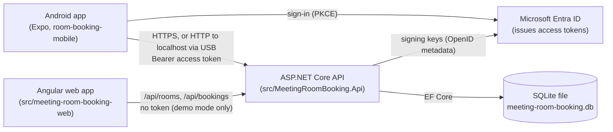

# Room Booking – Developer Walkthrough (API and web)

This document explains the system from a developer's perspective: what it
does, how a request travels through it, why it is built this way, and where
its limits are. It describes the code as it is, and links to the source.

The mobile client has its own walkthrough in
[room-booking-mobile/docs/PROJECT_WALKTHROUGH.md](https://github.com/kris7011/room-booking-mobile/blob/main/docs/PROJECT_WALKTHROUGH.md).

**Status labels used throughout**

| Label | Meaning |
| --- | --- |
| **[Tested]** | Implemented and covered by automated tests that run in CI. |
| **[Manual]** | Implemented; verified only by hand, or not verified at all. |
| **[In review]** | Implemented on an open pull request, not yet on `main`. |
| **[Not implemented]** | Proposed or future work. Nothing in the code does this yet. |

Last reviewed: 2026-10-24, after backend PR #13 was merged into `main`
(merge commit `c39ea4a`; validated feature commit `228e1eb`).

---

## 1. System overview

Room Booking lets organisations manage meeting rooms and lets their members
find a free room and book it. People sign in with a Microsoft account. Every
organisation's rooms and bookings are visible only to its members.



- The **API** is the only component that decides who a caller is and what
  they may do. Clients are conveniences.
- **Microsoft Entra ID** authenticates people. The API never sees a password
  and has no client secret: it only validates tokens.
- **SQLite** is a single file. That keeps the system runnable on one PC
  without a database server, which matters for the
  [local-operation goal](#11-backup-and-restoration).

## 2. Repository structure

```text
src/MeetingRoomBooking.Api/
  Program.cs                      Composition root: services, middleware, endpoint groups, start-up
  Data/
    BookingDbContext.cs           EF Core model: tables, keys, check constraints, indexes
    Migrations/                   Schema history (EF Core), including SQL triggers
    DatabaseInitializer.cs        Start-up: backup → migrate → verify invariants
    DatabaseBackup.cs             Verified backups: one snapshot, copied and fingerprinted
    DatabasePortability.cs        Manual backup and restore-to-new-file   [Tested]
  Features/                       One folder per feature: entity, contracts, endpoints, service
    Authentication/               Entra token validation
    Users/                        Signed-in identity, /api/me, registration
    Organizations/                Organisations, memberships, invitations, access control
    Rooms/                        Rooms and room administration
    Bookings/                     Bookings
    Audit/                        Audit event entity
    ApiProblems.cs                Problem Details with stable error codes
src/meeting-room-booking-web/     Angular 21 client (original assignment UI)
tests/MeetingRoomBooking.Api.IntegrationTests/
tools/RoomBooking.DatabaseTool/   CLI for backup/restore                  [Manual]
scripts/                          Start-Local, Backup-Local, Restore-Local [Manual]
```

The backend is **feature-oriented**: everything about bookings lives in
`Features/Bookings`, rather than spread over `Controllers/`, `Services/` and
`Models/` folders. A reader who wants to understand bookings opens one folder.

## 3. Technologies and their responsibilities

| Technology | Responsibility here |
| --- | --- |
| .NET 10, ASP.NET Core Minimal APIs | HTTP endpoints, endpoint groups and filters, dependency injection |
| Microsoft.AspNetCore.Authentication.JwtBearer + Microsoft.IdentityModel | Validating Entra access tokens (signature, issuer, audience, lifetime) |
| Entity Framework Core 10 + SQLite provider | Data access, migrations, LINQ queries translated to SQL |
| SQLite | The database: one file, with check constraints, foreign keys, triggers |
| xUnit + `WebApplicationFactory` | Integration tests against the real application and a temporary database |
| Angular 21, Signals, Reactive Forms, Tailwind CSS 4, Vitest | The web client |
| GitHub Actions | CI: backend build and tests, database tool build, frontend build and tests |
| PowerShell | Local start, backup and restore scripts for Windows [Manual] |

## 4. How a request flows through the API

[`Program.cs`](../src/MeetingRoomBooking.Api/Program.cs) wires the pipeline in
this order:

1. `UseExceptionHandler` – unhandled exceptions become Problem Details.
2. `UseCors` – only in Development, only for origins in
   `appsettings.Development.json`.
3. `UseAuthentication` / `UseAuthorization` – JWT bearer validation.
4. Swagger (Development only); HTTPS redirection (outside Development and Testing).
5. Endpoint groups, each with its own authorization and filters.

Before the app accepts requests it runs `InitialiseDatabaseAsync` (backup,
migrate, verify; see [section 7](#7-persistence)) and
`ApplyLegacyOwnerBootstrapAsync` (see [section 8.5](#85-the-first-owner-of-the-legacy-organisation)).

### Example: a member books a room

```mermaid
sequenceDiagram
    participant C as Client
    participant J as JwtBearer + SignedInUserPolicy
    participant F as OrganizationAccessFilter
    participant E as Booking endpoint
    participant S as BookingService
    participant D as SQLite

    C->>J: POST /api/organizations/{id}/bookings<br/>Authorization: Bearer …
    J->>J: signature, issuer, audience, lifetime, scp, tid, oid
    J-->>C: 401 / 403 if invalid
    J->>F: validated ClaimsPrincipal
    F->>D: user by (iss, oid); membership of {id}
    F-->>C: 403 not registered/disabled, 404 not a member
    F->>E: CurrentOrganization.Caller set
    E->>E: BookingRequestValidator.Validate → 400
    E->>S: CreateAsync(organizationId, request, actor)
    S->>D: BEGIN IMMEDIATE
    S->>D: active room in this organisation? overlap?
    S->>D: INSERT booking (trigger re-checks overlap)
    S->>D: COMMIT
    S-->>E: booking, or a failure enum
    E-->>C: 201, or 400 / 404 / 409 Problem Details
```

Two design points are visible here:

- **Authorization runs before the endpoint.** The organisation filter is
  attached to the route *group*, so no endpoint in the group can forget it.
- **Services return result enums, not HTTP results.** `BookingService`
  returns `BookingMutationFailure` values;
  `BookingEndpoints.HandleMutationFailure` maps them to status codes. The
  business logic does not depend on HTTP, and the mapping is in one place.

## 5. Authentication [Tested]

Code: [`EntraAuthentication.cs`](../src/MeetingRoomBooking.Api/Features/Authentication/EntraAuthentication.cs),
[`EntraIssuerValidator.cs`](../src/MeetingRoomBooking.Api/Features/Authentication/EntraIssuerValidator.cs),
[`SignedInIdentity.cs`](../src/MeetingRoomBooking.Api/Features/Users/SignedInIdentity.cs).

The API is a **resource server**: clients obtain Entra v2.0 access tokens and
send them as `Authorization: Bearer`. `AddEntraAuthentication` configures JWT
bearer validation:

| Check | How |
| --- | --- |
| Signature | RS256 only (`ValidAlgorithms`), keys from Entra's OpenID metadata (`common`, or `organizations` when personal accounts are off). `RequireSignedTokens`. |
| Signing key belongs to the issuer | `EnableAadSigningKeyIssuerValidation()` |
| Issuer | `EntraIssuerValidator.Validate`: `iss` must equal `https://login.microsoftonline.com/{tid}/v2.0` for the token's own `tid`; allowed tenants are configurable; v1.0 issuers are rejected. |
| Audience | The API's client ID or `api://{client ID}` |
| Lifetime | `exp` required, 2 minutes clock skew |
| Delegated user | Policy `SignedInUserPolicy` requires `tid`, `oid` and the `access_as_user` scope in `scp`, so app-only tokens never pass as a user. |

**Identity key.** A person is identified by the validated issuer plus `oid`
(object ID), stored as a unique index on `UserIdentities (Issuer, Subject)`.
The e-mail address is never a key: two Microsoft accounts with the same
address remain two users.

**Verified e-mail.** `SignedInIdentity.ReadVerifiedEmail` trusts the `email`
claim only when the token also carries `xms_edov: true`. A verified e-mail is
used for exactly one thing: matching an invitation's address.

**Not configured.** Without `Entra:ApiClientId` the API still starts; signed-in
endpoints answer `503 authentication_not_configured`.

**What the tests do not cover:** tests sign tokens with a key that exists only
in the test process ([`EntraTestTokens.cs`](../tests/MeetingRoomBooking.Api.IntegrationTests/Authentication/EntraTestTokens.cs)).
Validation against Microsoft's real metadata and real tokens is **[Manual]**.

## 6. Authorization and multi-tenancy [Tested]

Code: [`OrganizationAccess.cs`](../src/MeetingRoomBooking.Api/Features/Organizations/OrganizationAccess.cs),
[`LegacyApiAccess.cs`](../src/MeetingRoomBooking.Api/Features/Organizations/LegacyApiAccess.cs).

Every organisation endpoint is mapped inside `MapOrganizationGroup`, under
`/api/organizations/{organizationId:guid}`. The group requires
`SignedInUserPolicy` and runs `OrganizationAccessFilter` before every endpoint:

| Step | Failure |
| --- | --- |
| Valid token (policy) | 401 / 403 |
| Identity is registered | 403 `user_not_registered` |
| User is not disabled | 403 `user_disabled` |
| Caller is a member of the organisation in the route | **404** `organization_not_found` |
| Endpoint's role requirement (`RequireOwnerOrAdmin`, `RequireOrganizationRole`) | 403 `organization_permission_denied` |

- **404, not 403, for non-members:** an outsider cannot even tell whether an
  organisation exists.
- **Roles come from the database on every request**, never from the token or
  the request body.
- **Queries are scoped as well.** For example, `BookingService.BookingsOf`
  filters by `OrganizationId`, so a booking ID from another organisation is
  "not found" even if it exists. Integer IDs are guessable; guessing one never
  crosses the tenant boundary.
- **Per-object rules** live in the service: `BookingActor.MayModify` lets
  Owners and Admins change any booking, Members only their own.

| Role | Rooms and bookings | Administration |
| --- | --- | --- |
| Owner | Book; change/delete any booking | Rooms, invitations (Admin, Member), roles, remove members, rename |
| Admin | As Owner | Rooms, member list, invite Members, revoke Member invitations |
| Member | Search and book; change/delete own bookings | Leave the organisation |

The full endpoint-by-role matrix, with the test that proves each cell, is in
[role-permission-matrix.md](role-permission-matrix.md). `RolePermissionMatrixTests`
reads the route table and fails if an endpoint's role requirement no longer
matches it.

**Legacy endpoints.** `/api/rooms` and `/api/bookings` are the original
assignment endpoints. They always work on the legacy organisation and are
protected by the same filter with a fixed organisation ID. `LegacyApi:AllowAnonymous`
re-enables anonymous access for demos, and `LegacyApiOptions.Read` **refuses
to start the API** with that setting outside the Development and Testing
environments.

## 7. Persistence

Code: [`BookingDbContext.cs`](../src/MeetingRoomBooking.Api/Data/BookingDbContext.cs),
[`Migrations/`](../src/MeetingRoomBooking.Api/Data/Migrations),
[`DatabaseInitializer.cs`](../src/MeetingRoomBooking.Api/Data/DatabaseInitializer.cs).

### Tables

`Organizations`, `MeetingRooms`, `Bookings`, `Users`, `UserIdentities`,
`Memberships`, `Invitations`, `AuditEvents`, plus EF Core's
`__EFMigrationsHistory`.

### Invariants enforced by the database [Tested]

The services check the business rules first, so users get good error messages.
The database enforces the critical ones again, so a bug, a second code path or
a manual SQL statement cannot break them:

| Invariant | Mechanism |
| --- | --- |
| No two bookings of a room overlap | Triggers `TR_Bookings_Overlap_Insert/Update` (`RAISE(ABORT, 'booking_overlap')`) |
| A booking belongs to its room's organisation | Composite foreign key `(OrganizationId, RoomId)` → `MeetingRooms (OrganizationId, Id)` |
| An organisation never loses its last Owner | Triggers `TR_Memberships_LastOwner_Delete/Update` (`last_owner`) |
| End after start; valid roles; lower-case e-mails; token hash shape | Check constraints |
| One open invitation per e-mail and organisation; unique active room names | Filtered unique indexes |

`BookingService` catches the trigger error (`SqliteException` code 19 with
`booking_overlap`) and returns the same 409 as its own check.
`BookingConcurrencyTests` proves that direct SQL inserts and updates cannot
bypass the overlap rule.

**Timestamps** are stored as UTC ticks in `INTEGER` columns (a value converter
in `BookingDbContext`), so comparisons in triggers and queries are numeric and
independent of time zones and text formats.

### Transactions and concurrency [Tested]

Each change runs in one transaction started with
`Database.BeginTransactionAsync()`. With Microsoft.Data.Sqlite, a non-deferred
transaction (the default) is issued as `BEGIN IMMEDIATE`, which takes SQLite's
write lock at the start. "Check, then write" sequences (overlap check then
insert; "is this the last Owner?" then delete; idempotency lookup then insert)
therefore cannot interleave with another writer.

Note that this guarantee comes from a **library default**, not from anything
visible in the calling code. Switching database provider, or passing
`deferred: true`, would change it; the database triggers remain the backstop.

### Start-up: migrate safely [Tested]

`DatabaseInitializer.InitialiseAsync` runs before the API accepts requests:

1. If migrations are pending and the database file already has data, it takes
   a verified backup first (`DatabaseBackup.CreateVerifiedAsync`, see
   [section 11](#11-backup-and-restoration)). If the backup fails, nothing is
   migrated and no backup file is left behind.
2. A non-empty file **without** migration history is refused untouched: its
   schema is unknown.
3. After migrating, `VerifyAsync` checks foreign keys, integrity and that all
   four triggers exist. Otherwise the API does not start.

## 8. Core workflows

### 8.1 Registration [Tested]
`POST /api/me/registration` → `UserRegistrationService`. One `BEGIN IMMEDIATE`
transaction looks up `(iss, oid)` and creates `User` + `UserIdentity` if
missing: `201` the first time, `200` afterwards. A unique-index violation from
a concurrent writer is answered with that writer's user. A test sends 12
parallel first registrations and expects exactly one user. Registration grants
no memberships.

### 8.2 Creating an organisation [Tested]
`POST /api/organizations` with an `Idempotency-Key` header →
`OrganizationService`. Repeating the same key and name returns the original
organisation (`200`, `Idempotent-Replayed: true`); the same key with another
name is `422`. The organisation, the Owner membership and two audit events are
written in one transaction. Limit: 10 per user per 24 hours (`429`). A test
sends 8 parallel requests with the same key and expects one `201` and seven
replayed `200`s (`ParallelRequests_WithTheSameKey_CreateOneOrganization`).

### 8.3 Invitations [Tested]
Code: `InvitationService`, [`InvitationToken.cs`](../src/MeetingRoomBooking.Api/Features/Organizations/InvitationToken.cs).

- Creating: 32 random bytes, base64url. The token is returned **once**; the
  database stores only its SHA-256 hash, so a stolen database copy cannot be
  used to accept invitations. Valid for 7 days.
- Accepting requires **both** the token and a verified e-mail equal to the
  invited address: the token proves the link arrived, the e-mail proves who
  opened it. The inviter must still have the right to invite that role.

### 8.4 Bookings [Tested]
`BookingService.CreateAsync` / `UpdateAsync` / `DeleteAsync`:

- Start must be after the server's current time (`TimeProvider`, replaceable
  in tests). Updates that keep the period are allowed for past bookings.
- The room must be active and in the caller's organisation.
- Overlap check excludes the booking being updated; adjacent bookings
  (10:00–11:00 after 09:00–10:00) are allowed.
- Members may only change their own bookings.

### 8.5 The first Owner of the legacy organisation [Tested]
`LegacyOwnerBootstrap`: the configuration value
`Organizations:InitialLegacyOwnerUserId` makes a registered user the first
Owner, only while the legacy organisation has no Owner. Later members join by
invitation.

### 8.6 Members and rooms [Tested]
`MembershipService` changes roles and removes members (the last Owner cannot
be demoted or removed: service check plus triggers). `RoomAdministrationService`
creates, edits, archives and restores rooms; rooms are never deleted, and
archiving is refused while a room has upcoming bookings. All changes write
audit events (`AuditEventType`). There is **no endpoint to read audit events**
yet [Not implemented].

### Error contract
Errors are Problem Details (RFC 9457). Business and access errors are created
in [`ApiProblems.cs`](../src/MeetingRoomBooking.Api/Features/ApiProblems.cs)
and carry a stable `code` extension (for example `booking_overlap`,
`organization_not_found`); clients branch on `code`, while `title` and
`detail` are for people. Input validation errors are standard
`ValidationProblem` responses (400) with an `errors` object per field.

## 9. Testing strategy

| Layer | What | Where |
| --- | --- | --- |
| API integration | The real app via `WebApplicationFactory`, environment `Testing`, a temporary SQLite file per factory, `Pooling=False` | `MeetingRoomBookingApiFactory` |
| Authentication | Tokens signed with a test-only RSA key; production validation code otherwise unchanged | `EntraTestTokens`, `CurrentUserEndpointTests` |
| Time | `TestTimeProvider` replaces `TimeProvider`, so "must start in the future" tests do not decay | `BookingTimeValidationTests` |
| Concurrency | Parallel requests; direct SQL that tries to bypass triggers | `BookingConcurrencyTests`, `RegistrationEndpointTests` |
| Migrations | Databases built from older schemas with raw SQL, then migrated; data, IDs and triggers checked | `Migrations/*` |
| Backup/restore | Snapshot round trip, WAL contents, no-overwrite rules, restored DB passes start-up checks | `DatabasePortabilityTests` [Tested] |
| Backup under writes | Repeated backups and restores while another connection commits bookings; a commit exactly between snapshot and copy; a saved but uncommitted booking; clean-up after a failed backup; no overwrite; fingerprints | `DatabaseBackupConcurrencyTests`, `DatabaseBackupTests` [Tested] |
| Restored API | Two-tenant data backed up while the API runs, restored, and served by a second API: same rows, 401 without a valid token, 404 for non-members, roles intact, original unchanged | `RestoredDatabaseApiTests` [Tested] |
| Safety | `TestDatabaseGuard` refuses any database outside the temp folder or inside the API project | `TestDatabaseGuard` |
| Web client | Angular service and component tests (Vitest), run in CI | `src/meeting-room-booking-web` |
| End to end | The mobile repository's Playwright suite starts this API on a temporary database | room-booking-mobile `e2e/` |

The final Phase 4A validation on 2026-10-24 reported **303 passing backend tests**
(`dotnet test`, Release, Windows) at commit `228e1eb`, later merged in PR #13.
Phase 5A added `RolePermissionMatrixTests`: **309 passing** on 2026-10-26
(Release, Windows), on `main` at `c2ca321` plus that change.

**Not covered by automated tests:** real Entra tokens and metadata, a physical
device, production configuration, and performance under load.

## 10. Local development and deployment

- **Run the API:** `dotnet run --project src/MeetingRoomBooking.Api --launch-profile http`
  → `http://localhost:5003`. Set `Entra__ApiClientId` for signed-in endpoints.
- **Database location:** see [below](#which-database-file-the-api-uses).
- **Web client:** `npm --prefix src/meeting-room-booking-web start` →
  `http://localhost:4200`, proxied to the API. It calls the legacy endpoints
  without a token, so it needs `LegacyApi:AllowAnonymous=true` (Development only).
- **CI:** [`.github/workflows/ci.yml`](../.github/workflows/ci.yml) builds and
  tests backend and frontend on every push to `main` and every pull request.
- **Deployment: [Not implemented]** in this repository. There is no
  Dockerfile, infrastructure-as-code or deployment workflow; any hosting is
  configured outside the code.

### Which database file the API uses

There is exactly one input: the connection string `BookingDatabase`, read
once in [`Program.cs`](../src/MeetingRoomBooking.Api/Program.cs)
(`GetConnectionString("BookingDatabase")`, lines 13–17). If it is missing,
the API refuses to start. ASP.NET Core configuration resolves it from the
usual sources, the later winning:

1. `appsettings.json`: `Data Source=meeting-room-booking.db`.
2. `appsettings.{Environment}.json` (does not set it today).
3. Environment variables: `ConnectionStrings__BookingDatabase`
   (the double underscore stands for `:`).
4. Command-line arguments.

A relative `Data Source` is resolved against the **process working
directory**, not the project folder. `dotnet run --project …` from the
repository root and from `src/MeetingRoomBooking.Api` would therefore open
different files. `scripts/Start-Local.ps1` [Manual] removes that ambiguity:
it turns `-DatabaseFile` into an absolute path, refuses to start when the file
is missing (unless `-InitializeEmpty`), prints the path, and sets
`ConnectionStrings__BookingDatabase` only for the API process, restoring the
previous value afterwards.

The automatic pre-migration backups go to `Database:BackupDirectory`, or to a
`backups` folder next to the database file when that is not set
([`DatabaseExtensions.cs`](../src/MeetingRoomBooking.Api/Data/DatabaseExtensions.cs),
`DatabaseBackup.CreateVerifiedAsync`). The integration tests set both values
to files in the temp folder, and `TestDatabaseGuard` refuses any database
outside it.

## 11. Backup and restoration

| Capability | Status |
| --- | --- |
| Verified backup before every migration of an existing database | [Tested] |
| Manual backup: `scripts/Backup-Local.ps1` → `RoomBooking.DatabaseTool backup` | [Manual], tested on a development-data copy |
| Restore into a **new** file only: `scripts/Restore-Local.ps1` → `restore` | [Manual], tested on a development-data copy |
| Start the API on a chosen database file: `scripts/Start-Local.ps1` | [Manual], tested on a development-data copy |
| API on a restored file still enforces sign-in and tenant boundaries | [Tested] (`RestoredDatabaseApiTests`) |
| Recovery test with a copy of the real development data | [Manual], 2026-10-24 (see [local-portability.md](local-portability.md#recovery-test-on-a-copy-of-the-real-data-2026-10-24)), including invariant and WAL-only-commit checks on copies ([follow-up](local-portability.md#follow-up-checks-on-the-same-copies-2026-10-24)) |
| Automatic scheduled or off-site backups | [Not implemented] |
| Export/import between different database engines | [Not implemented] |

How restore protects data (`DatabasePortability.RestoreToNewAsync`):

1. Refuses if source equals destination, or if the destination or a leftover
   `-wal`/`-shm` file exists.
2. In one read transaction on the backup, verifies it (`integrity_check`,
   `foreign_key_check`) and fingerprints it (see below).
3. Copies with SQLite's backup API into a temporary file next to the
   destination, and switches it to WAL mode like the API's own databases.
4. Verifies the copy again (integrity, foreign keys, identical fingerprints).
5. `File.Move` without overwrite: atomic on the same volume, and it fails
   rather than replace a file that appeared in the meantime.

**How a backup is made** (`DatabasePortability.BackupAsync` and the API's
start-up both call `DatabaseBackup.CreateVerifiedAsync`) [Tested]:

1. The source is opened **read-only**, and a deferred read transaction
   (`BeginTransaction(deferred: true)`) is started on it. SQLite fixes that
   transaction's snapshot at its first read and keeps it until it ends, even
   while the API commits more bookings (WAL mode).
2. Inside that transaction, `FingerprintAsync` records each table's row count
   and an order-independent hash of its rows (the sum of truncated SHA-256
   row hashes), plus the same for the schema (`sqlite_master`, so indexes and
   triggers are compared too) and `sqlite_sequence` (the AUTOINCREMENT
   counters).
3. Still inside it, `SqliteConnection.BackupDatabase` (SQLite's online backup
   API) copies **that same snapshot** into `<backup>.partial-<id>.tmp`, which
   is then switched to a rollback journal so that the backup is one
   self-contained file.
4. The copy must pass `PRAGMA integrity_check` and `PRAGMA foreign_key_check`
   and have exactly the fingerprints from step 2.
5. Only then does `File.Move` (no overwrite) give it its final name
   `<database>.manual-<UTC timestamp>.db` (or `.pre-<migration>-…`). On any
   failure, `finally` deletes the temporary file and its own sidecars, nothing
   else.

Because the copy and the reference values come from one snapshot, a booking
committed during the backup can neither be half-included nor make
verification fail. Commits that still sit in the `-wal` file are included,
which a plain file copy of a running database would miss.

Earlier versions used `VACUUM INTO`, which also writes a consistent snapshot,
but SQLite refuses to run it inside a transaction ("cannot VACUUM from within
a transaction"). Its snapshot and the row counts it was compared with were
therefore taken at different moments, and a booking committed in between
produced a false "does not have the same rows" failure. The reasoning is in
[ADR 0003](adr/0003-portable-sqlite-backup-and-restore.md).

**Why restore never overwrites.** A restore is only ever needed when something
has gone wrong, which is also when a mistake is most likely: the wrong file
chosen, an older backup picked, a path typed into the wrong field. If restore
could replace a database, one such slip would destroy the only good copy, and
the damage would be invisible until someone missed a booking. Writing to a new
file makes every restore reversible: the original stays where it was, the
restored copy can be inspected and started on its own, and "switching over"
is a separate, deliberate step (`Start-Local.ps1 -DatabaseFile …`). Checking
for leftover `-wal`/`-shm` files matters too: SQLite would apply an old
database's WAL to a new file of the same name and corrupt it.

Step-by-step instructions: [local-portability.md](local-portability.md).
Rationale: [ADR 0003](adr/0003-portable-sqlite-backup-and-restore.md).

## 12. Design decisions and trade-offs

| Decision | Why | Cost | Record |
| --- | --- | --- | --- |
| Tenant isolation in one route-group filter plus scoped queries | Cannot be forgotten per endpoint; 404 hides other tenants | Every organisation request makes a membership query | [ADR 0001](adr/0001-organisation-scoped-access-control.md) |
| Critical invariants in SQLite triggers as well as services | Holds under races, bugs and manual SQL | Logic in two places; SQLite-specific SQL in migrations | [ADR 0002](adr/0002-database-enforced-invariants.md) |
| SQLite file + verified snapshots, restore to new file only | Runs anywhere without a server; cheap, portable backups | One writer at a time; one API instance; no automatic sync | [ADR 0003](adr/0003-portable-sqlite-backup-and-restore.md) |
| Feature folders | A feature is understood by opening one folder | Shared concerns (`ApiProblems`, `Data`) sit beside features | – |
| Result enums from services, HTTP mapping in endpoints | Services testable and HTTP-agnostic | Some mapping code per feature | – |
| `TimeProvider` injected | Time-dependent rules testable at exact instants | – | – |
| Identity = issuer + `oid`, never e-mail | E-mail is mutable and not unique across account types | Linking two accounts of one person is not supported yet | – |

## 13. Known limitations

- **Single writer, single instance.** SQLite serialises writes, and the
  database is a local file, so the API must run as one instance with
  persistent disk.
- **Sign-in needs the internet.** Entra is an external identity provider;
  fully offline sign-in is not possible with this design.
- **The Angular web client has no sign-in.** It only works with the
  Development-only anonymous mode of the legacy endpoints. CORS also does not
  allow the `Authorization` header yet.
- **No deployment or production configuration in the repository.**
- **Restore does not check versions.** A backup made by a newer API version
  can be restored and started by an older one; nothing warns about it.
- **A killed backup can leave a `*.partial-<id>.tmp` file.** It never has a
  backup's name and is safe to delete. Backups are not compacted (the backup
  API copies pages as they are, unlike `VACUUM INTO`).
- **The backup fingerprint is not tamper-proof.** It detects an incomplete or
  accidentally different copy, not a deliberately crafted one.
- **One `Start-Local.ps1` per checkout.** It builds Debug in place, and a
  running instance locks the output, so a second instance fails at the build.
- **No account linking**, no audit-log endpoint, no pagination, no general
  rate limiting (only organisation creation is limited).
- **Transaction mode is implicit** (see [section 7](#transactions-and-concurrency-tested)).
- **Room and booking changes use the role read at the start of the request.**
  Only `MembershipService` reads the caller's role again under the write
  lock, so a request already running when its caller is demoted can still
  finish; the next one is refused (see
  [role-permission-matrix.md](role-permission-matrix.md#known-limitation)).

## 14. How this project was built

This project was developed with AI assistance (Claude Code). Some commits
carry a `Co-Authored-By: Claude` trailer; those trailers are not a complete
record of AI involvement.

Every change is verified the same way regardless of who wrote it: the
automated test suite and CI must pass, database changes are tested on copies
of real data, never the original, and behaviour on a physical device is
checked by hand. The [Status labels](#room-booking--developer-walkthrough-api-and-web)
in this document record which of those checks applies to each part.
