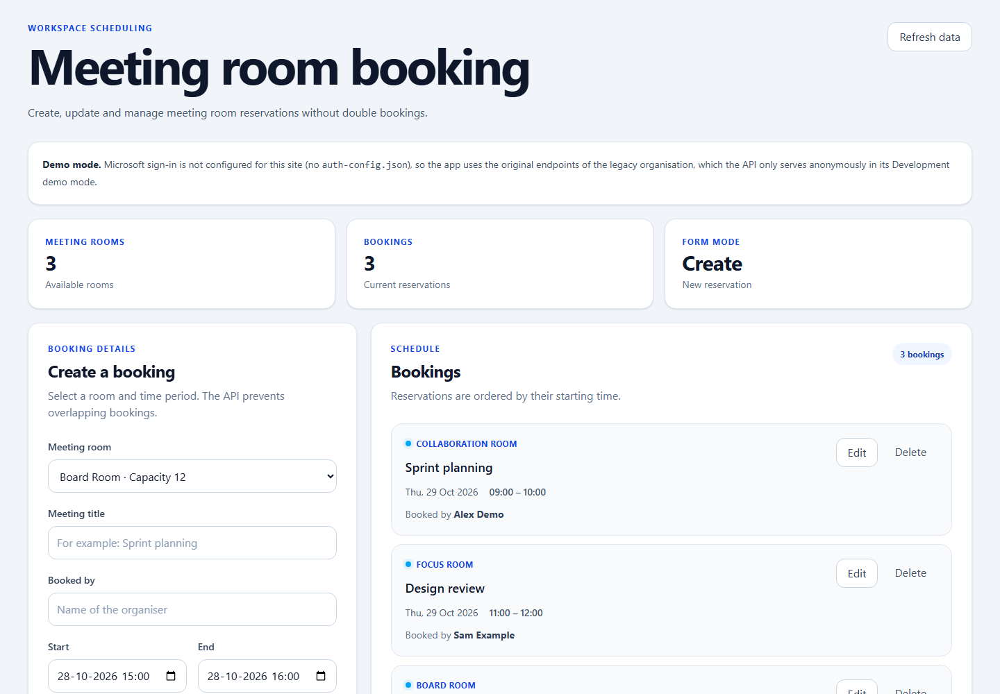

# Recruiter quick review — Room Booking

**What it demonstrates:** C# / ASP.NET Core 10, Angular 21, Entity Framework Core + SQLite, API design, Microsoft Entra authentication, multitenant authorisation, data privacy, idempotency and concurrency testing.

**Cost:** Free local demo. No cloud account, paid hosting or Microsoft account is needed to try the *anonymous demo*. The real organisation and sign-in features need a separately configured Microsoft Entra registration; do not confuse those with the anonymous demo.

## First look without installing anything



- [System and feature overview](../README.md#what-it-does)
- [Architecture and API trust boundary](../README.md#system-overview)
- [Technical walkthrough](PROJECT_WALKTHROUGH.md)
- [Automated tests and limitations](../README.md#testing-and-ci)
- [Mobile client with Android and web screenshots](https://github.com/kris7011/room-booking-mobile#screenshots)

## Try it on your machine

Requirements: .NET 10 SDK, Node.js 22 or later, npm, and PowerShell (Windows PowerShell 5.1 or PowerShell 7). Use two terminals. Clone the repository first:

```powershell
git clone https://github.com/kris7011/meeting-room-booking.git
cd meeting-room-booking
```

**Terminal 1 — start a safe, separately stored demo API with example bookings:**

```powershell
./scripts/Start-Demo.ps1
```

The API listens at `http://localhost:5003`. Its database is stored in `.demo/room-booking-demo.db`, not the developer's regular database. Press Ctrl+C to stop it. Use `./scripts/Start-Demo.ps1 -Reset` only if you intentionally want to discard this **demo** database.

**Terminal 2 — start the Angular browser client from the repository root:**

```powershell
npm --prefix src/meeting-room-booking-web ci
npm --prefix src/meeting-room-booking-web start
```

Open **http://localhost:4200**. The API's interactive documentation is available at **http://localhost:5003/swagger** while the Development demo server is running.

The demo launcher is already exercised by the repository's CI; this guide does not add or claim new runtime validation.

## Five-minute code-review tour

1. **Book a room in the Angular demo.** See the synthetic rooms and bookings; create a booking, then try the same room during an overlapping interval. The API rejects the conflict, rather than trusting the UI.
2. **Try a back-to-back time slot.** Adjacent bookings are allowed; overlapping ones are not.
3. **Inspect tenant and role enforcement.** Read the [backend walkthrough](PROJECT_WALKTHROUGH.md) and [client capability comparison](../README.md#what-each-client-does). The anonymous demo deliberately does **not** grant access to organisation administration.
4. **Inspect concurrency and retries.** The integration tests check simultaneous bookings, idempotency, validation, access checks and database migrations.
5. **Review the companion mobile client.** The [React Native / Expo repository](https://github.com/kris7011/room-booking-mobile) documents Android testing, web-demo screenshots and remaining mobile limitations.

## What the demo does not prove

A local anonymous demo does not demonstrate a live Microsoft sign-in or genuine cross-organisation interaction. Those paths are separately implemented and covered by tests and documented manual checks, but require their own identity setup. The project is designed for local, single-instance operation with SQLite, not as a production-hosted service. See [known limitations](../README.md#known-limitations).

**For an interview:** ask why bookings and permission checks must be enforced inside the API transaction, how concurrent attempts are handled, and why members cannot receive other users' booking details.
